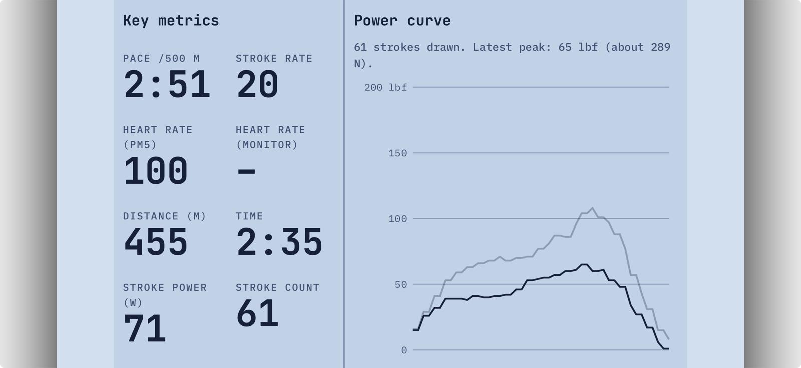

# What the Concept2 PM5 sends over Bluetooth

A short field guide, written while building this project. It covers what the PM5 rowing monitor shares with a web page, what we confirmed on real rows, and the surprises along the way.

You can try it yourself with the data explorer: **[marcolobato.github.io/erg-games/lab.html](https://marcolobato.github.io/erg-games/lab.html)** (Chrome or Edge on a laptop, Chrome on Android, or downloading the Bluefy browser on iPhone).

## The short version

- Everything you see on the PM5 screen is available: pace, stroke rate, distance, time, power, stroke count, heart rate, and the force curve.
- **Heart rate** comes through the PM5 if your strap is paired to the erg. No separate connection needed.
- **The force curve** (the PM5's power graph) arrives once per stroke, **after** the drive. It cannot be shown live during the pull, but it is close enough to check your leg drive stroke by stroke.
- A web page can read all of it with Web Bluetooth. iPhone needs the Bluefy browser, because Safari and every other iPhone browser do not support Web Bluetooth.

## How the connection works

- The PM5 shows up as a Bluetooth device whose name starts with `PM5`. Pull the handle to wake it.
- It only talks to one app at a time. Close ErgData or any other rowing app first.
- If you choose "Disconnect app" in the PM5's menu, it refuses every app until you press "Re-enable App Connection" on the PM5. Until then, connecting just waits. Seen on a real PM5 on 2026-11-13.
- Everything lives under one "rowing service". Each kind of data is a separate stream, and the page asks to be notified when a stream changes.
- All the stream ids follow one pattern: `ce0600XX-43e5-11e4-916c-0800200c9a66`, where `XX` picks the stream.
- Writing `1` to stream `34` (sample rate) asks for status updates about twice a second.
- Numbers arrive as bytes, **low byte first**. So the pace bytes `17 5A` mean `0x5A17` = 23063 hundredths of a second = 3:50.6 per 500 m.

## The streams

| Id | Stream | What we use from it | Units | How often |
|---|---|---|---|---|
| `31` | General Status | elapsed time, distance, drag factor | 0.01 s, 0.1 m | about 2–3 times a second |
| `32` | Additional Status 1 | stroke rate, **pace per 500 m**, speed, **heart rate** | spm, 0.01 s, 0.001 m/s, bpm (255 = no strap) | about 2–3 times a second |
| `33` | Additional Status 2 | average power, calories, interval count | watts | about 2–3 times a second |
| `35` | Stroke Data | stroke count, drive time, peak and average force | count, 0.01 s, 0.1 lbf | twice per stroke |
| `36` | Additional Stroke Data | **power of each stroke** | watts | once per stroke |
| `3d` | Force Curve | the shape of each pull | lbf | once per stroke, in pieces |
| `3b` | Heart Rate Belt Info | which strap is paired | id | never appeared in our recordings |

Heart rate can also come straight from a chest strap or watch through the standard Bluetooth heart rate service (`heart_rate`), without the PM5. That works too, but straps often allow only one or two connections at once.

## The force curve, in more detail

The force curve is the graph on the PM5 that shows how hard you pull through one stroke: legs first, then the body swing, then the arms.

- It arrives **after each drive**, split into 6 to 8 pieces about 0.1 s apart, so a full curve takes about a second.
- Each piece is: one header byte (high half = how many pieces this curve has, low half = how many points are in this piece), a sequence number, then up to 9 points of two bytes each.
- Points are in **pounds of force (lbf)**. We checked: each curve's highest point matches the "peak force" the PM5 reports for that stroke. 1 lbf is about 4.45 newtons.
- The oldest PM5 hardware ("PM5v1") does not send it.

## Surprises along the way

- **Drawing the curve stretched to fit made easy strokes look hard.** A light 8 lbf stroke filled the whole graph. Fix: a fixed scale (0–200 lbf), so easy strokes stay low.
- **Connecting twice doubled every packet.** The page was listening twice, and the curve, which is rebuilt from numbered pieces, broke. Fix: connecting again replaces the old listener.
- **The curve felt a stroke late.** Fix: draw it piece by piece as it arrives, starting about 0.1 s after the drive, with the previous stroke faint behind it as a reference.
- **On iPhone the graph came out garbled.** The canvas's own built-in size fed back into the page layout in Safari's engine, so each stroke was drawn tiny and stretched. Fix: let a plain box set the size and pin the canvas inside it.
- **The phone must stay awake.** Locking the phone ends the Bluetooth connection. The page asks the browser to keep the screen on, and this works in Bluefy.

## Recordings

The data explorer can record every packet to a `.json` file. Each entry has the time in milliseconds, the stream name, and the raw bytes. Recordings make it possible to replay a real row later, to build and test without rowing.

## Sources

- Concept2, *PM CSAFE Communication Definition*, revision 0.31, linked from [concept2.com/support/software-development](https://www.concept2.com/support/software-development). The Bluetooth tables are around pages 14–45.
- [ErgometerJS](https://github.com/tijmenvangulik/ErgometerJS), a community JavaScript library, for cross-checking byte layouts.
- Two recorded rows on a PM5 with a Garmin chest strap (November 2026).

This project is not affiliated with Concept2.
